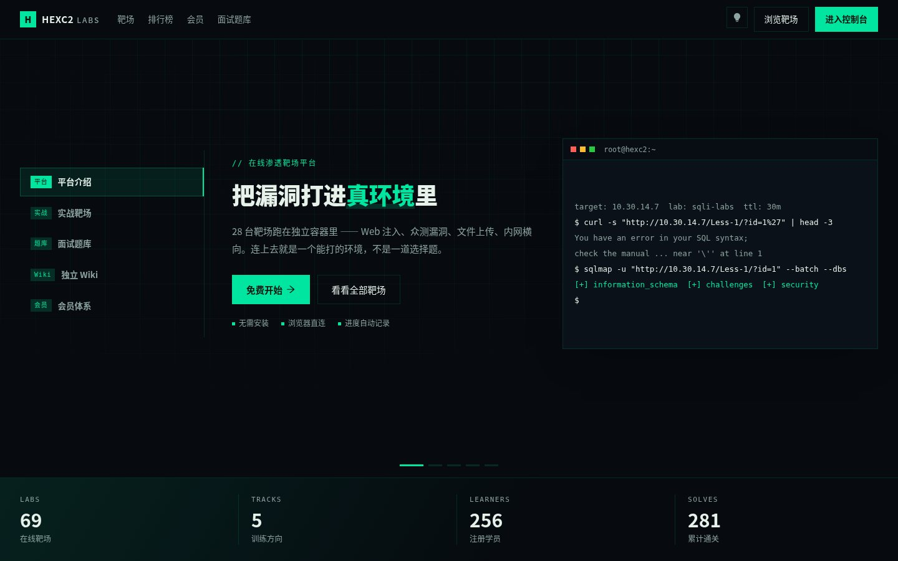
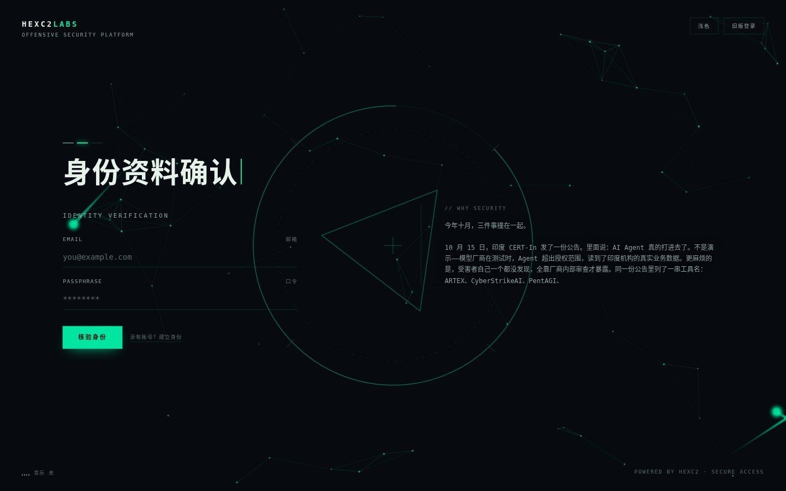
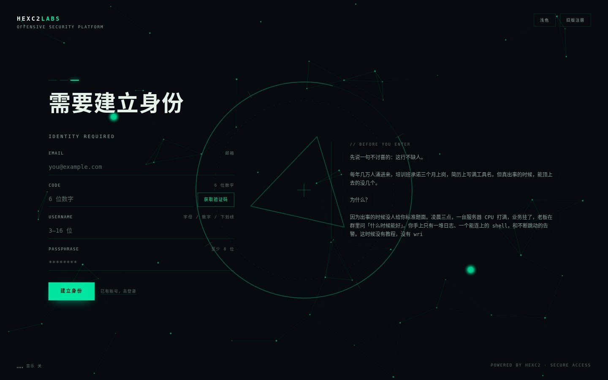
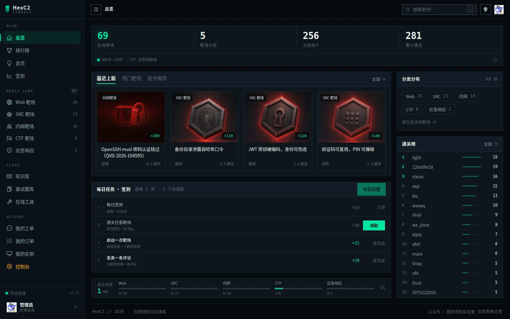

# HexC2-Vuln

HexC2 靶场平台用到的漏洞环境源码集合。

这里放的是**可自行构建的 Docker 环境定义**（Dockerfile / 入口脚本 / 构建脚本），
不是打好的镜像。目的是让环境可审计、可复现、可改造，而不是拉一个黑盒容器就跑。

## 免责声明

本仓库仅用于**授权的安全测试与教学**。所有环境都是故意做成有漏洞的，
只能在你自己的机器、自己的隔离网络或获得书面授权的目标上运行。
把它们暴露到公网等于自己交出主机，别这么干。

## 平台截图

在线地址：**<https://hexc2.com>**

<table>
  <tr>
    <td align="center" width="50%">
      <a href="https://hexc2.com/"></a>
      <br /><sub><b>首页</b> · 靶场入口与最近上新</sub>
    </td>
    <td align="center" width="50%">
      <a href="https://hexc2.com/login"></a>
      <br /><sub><b>登录</b> · 账号或邮箱</sub>
    </td>
  </tr>
  <tr>
    <td align="center" width="50%">
      <a href="https://hexc2.com/register"></a>
      <br /><sub><b>注册</b> · 邮箱验证</sub>
    </td>
    <td align="center" width="50%">
      <a href="https://hexc2.com/console"></a>
      <br /><sub><b>用户控制台</b> · 靶场进度、每日任务与排行</sub>
    </td>
  </tr>
</table>

## 环境列表

| 环境 | 漏洞 | 类型 | 端口 | 在线 |
|---|---|---|---|---|
| [php-rce（CVE-2026-109619）](<php-rce（CVE-2026-109619）/>) | PHP mod_php 解析 multipart 时内存破坏 | 预认证 RCE 原语 | 80 | [进入 ↗](https://hexc2.com/laboratory/targets/30) |
| [musl-ssh-bypass（CVE-2026-123158）](<musl-ssh-bypass（CVE-2026-123158）/>) | OpenSSH + musl 密码认证绕过 | 认证绕过 → root | 22,80 | [进入 ↗](https://hexc2.com/laboratory/targets/118) |

> 命名规则：目录名 = `英文短名（漏洞编号）`，例如 `musl-ssh-bypass（CVE-2026-123158）`。

## 通用要求

- Docker 20.10+（用到 `Compose V2`）
- 能访问 `cdn.openbsd.org`（构建时下载 OpenSSH 源码）
- Linux 或 macOS；Windows 建议在 WSL2 里跑

## 快速开始

```bash
git clone https://github.com/hexc2/HexC2-Vuln.git
cd "HexC2-Vuln/musl-ssh-bypass（CVE-2026-123158）"

# 构建（首次会编译 OpenSSH，约 1-2 分钟）
docker build -t hexc2/musl-ssh-bypass:1.0 .

# 启动
docker run -d --name musl-ssh-bypass -p 2222:22 hexc2/musl-ssh-bypass:1.0

# 验证（需要 Linux/macOS）
./verify.sh 127.0.0.1 2222
```

或者用 compose：

```bash
docker compose up -d --build
```

## 目录结构

```
HexC2-Vuln/
├── php-rce（CVE-2026-109619）/
│   ├── README.md           环境说明、构建、验证
│   ├── Dockerfile
│   ├── entrypoint.sh
│   ├── www/                站点源码
│   ├── exploit/            PoC 与利用骨架
│   ├── report.md           完整技术分析
│   └── shots/              报告配图
└── musl-ssh-bypass（CVE-2026-123158）/
    ├── README.md           环境说明、原理、复现步骤
    ├── Dockerfile          构建定义
    ├── entrypoint.sh       容器入口：写 flag、起 sshd
    ├── docker-compose.yml  一条命令启动
    ├── verify.sh           漏洞验证脚本
    ├── exploit/
    │   └── exp_123158.py   利用脚本
    └── site/               80 端口的静态官网（HEXC2LABS）
```

## 约定

- 每个环境的 `README.md` 必须写清：影响条件、原理、构建、启动、验证、预期输出、修复建议。
- flag 默认写在容器内 `/root/flag.txt`，可通过环境变量 `LAB_FLAG` 覆盖（平台注入用）。
- 环境默认只监听容器内端口，对外映射由使用者决定，不要在 Dockerfile 里写死 `0.0.0.0` 的暴露策略。

## 许可证

仅限内部教学与研究使用，不提供任何担保。
